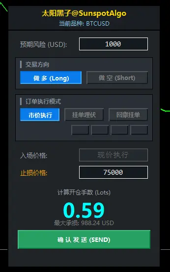
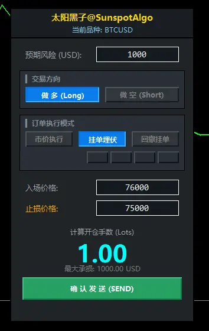
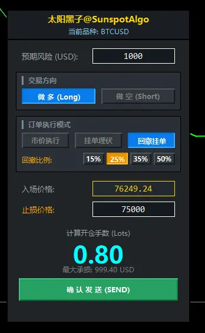
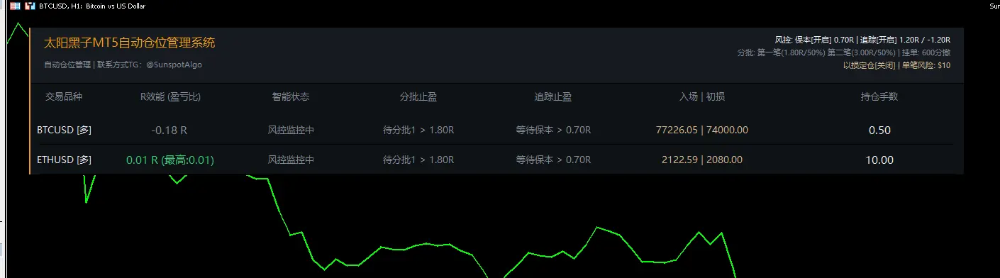
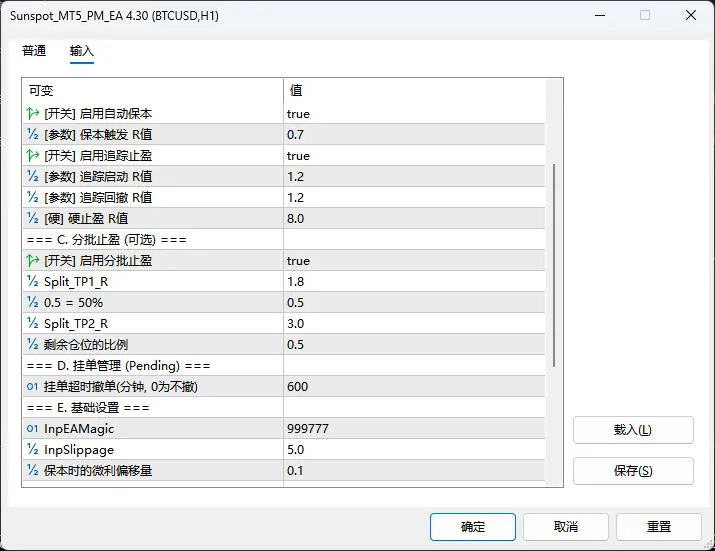

# SunspotAlgo MT5 Risk Management Tools (Open Source)

English | [简体中文](./README.zh-CN.md)

Two free, open-source MetaTrader 5 (MQL5) risk-management Expert Advisors built for **manual traders** on Windows and macOS (Wine / Retina DPI supported):

1. **[`SunspotAlgo_MT5_Risk_Lock.mq5`](./src/SunspotAlgo_MT5_Risk_Lock.mq5)** (`v2.26`) — Risk-based position sizing & order execution panel (market, limit/stop pending, and pullback entry).
2. **[`SunspotAlgo_MT5_Auto_Manager.mq5`](./src/SunspotAlgo_MT5_Auto_Manager.mq5)** (`v4.33`) — Post-entry position management dashboard (auto breakeven, R-based trailing stop, partial take-profit, hard TP protection, and pending-order timeout).

> **Important:** These tools **do not** generate directional trade signals or place automated directional bets. You remain responsible for market direction, trade plans, and risk decisions. They are completely free and independent from the [MiX TradingView signal indicator](https://sunspotalgo.com/en/).

---

## Companion Free Web Tools & Official Links

- **Official Website:** https://sunspotalgo.com/en/
- **Free Web Position Size Calculator (Forex / Gold XAUUSD / Crypto / MT5 specs):** https://sunspotalgo.com/en/tools/position-sizing/
- **Full MT5 Risk Tools Guide:** https://sunspotalgo.com/docs/mt5-tools/
- **Telegram Public Channel (Free 4H MiX Signals):** https://t.me/SunspotSignal
- **TradingView Script Page (MiX Indicator):** https://www.tradingview.com/script/u7G1zSjA/

---

## 1. SunspotAlgo_MT5_Risk_Lock (`v2.26`) — Position Sizing & Execution Panel

Define your maximum acceptable dollar risk first, set your stop-loss, and let the panel calculate executable lot size automatically before opening a trade.

### Features
- **Fixed-risk lot calculation:** Computes lot size from planned USD risk and stop-loss distance using real broker contract specifications.
- **Three execution modes:**
  - **Market Execution:** Immediate entry with pre-calculated risk and stop-loss.
  - **Pending Entry:** Limit/stop order at a planned entry price.
  - **Pullback Pending:** Automatic pullback entry based on configurable retrace percentage.
- **Cross-platform DPI & font scaling:** Built-in Windows and macOS / Wine font presets with Retina DPI compensation (`Inp_FontSet`, `Inp_UIScale`, `Inp_FontScale`, `Inp_AutoFitFont`).

### Screenshots

| Market Execution | Pending Entry | Pullback Pending |
| --- | --- | --- |
|  |  |  |

---

## 2. SunspotAlgo_MT5_Auto_Manager (`v4.33`) — Automatic Position Manager

An execution assistant that monitors open positions and pending orders according to your pre-defined R-multiple rules.

### Features
- **Auto Breakeven (`Enable_Auto_BE`):** Moves stop-loss to entry + offset (`BE_Offset_R`) once price reaches the trigger R-multiple (`Inp_BE_Trigger`).
- **R-Based Trailing Stop (`Enable_Hard_Trail`):** Activates after `Inp_Trail_Start` R and trails stop-loss by `Inp_Trail_Back` R, displaying the real locked R-multiple on the panel.
- **Partial Take-Profit (`Enable_Split_TP`):** Two-stage partial close at configurable R levels (`Split_TP1_R` / `Split_TP1_Pct`, `Split_TP2_R` / `Split_TP2_Pct`).
- **Hard Take-Profit & Bad-Tick Protection:** Multi-tick confirmation prevents anomalous zero/bad broker quotes from prematurely closing positions.
- **Pending Order Timeout (`InpPendingTimeout`):** Automatically cancels stale pending orders after N minutes (`0` disables).
- **Optional Scout-Order Risk Entry Module (`Enable_Risk_Entry`):** Optionally scales a small manual scout order to your target risk amount (`Inp_Risk_Money`).

### Screenshots

---

## Installation & Compilation

1. Download [`src/SunspotAlgo_MT5_Risk_Lock.mq5`](./src/SunspotAlgo_MT5_Risk_Lock.mq5) and/or [`src/SunspotAlgo_MT5_Auto_Manager.mq5`](./src/SunspotAlgo_MT5_Auto_Manager.mq5).
2. In MetaTrader 5, open **File → Open Data Folder → `MQL5/Experts/`** and copy the `.mq5` file(s) there.
3. Open **MetaEditor**, load the `.mq5` file, and click **Compile** (`F7`).
   - **macOS (Apple Silicon / Wine) note:** Set MetaEditor CPU architecture to **X64 Regular** before compiling to avoid `failed [568]`, and set `Inp_FontSet = FONTSET_MACOS` in EA inputs.
4. Enable **Algo Trading** in MetaTrader 5 and attach the EA to your chart.

---

## Disclaimer

Trading forex, gold, indices, and cryptocurrencies with leverage carries a high level of risk and may result in the loss of all invested capital. These open-source utilities are provided "as is" under the MIT License for workflow and risk-calculation assistance only, with no guarantee of execution accuracy, broker compatibility, or trading performance. Always test thoroughly on a demo account before using on a live account.

Read the full risk disclosure: https://sunspotalgo.com/risk/
