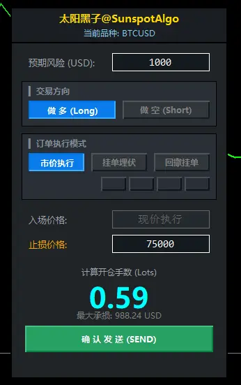
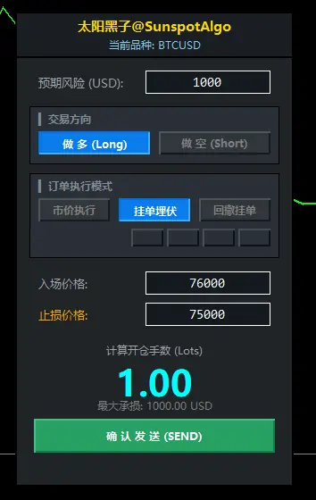
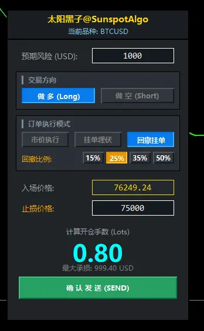
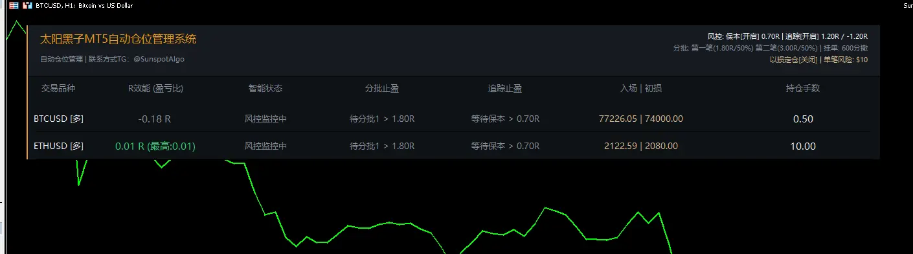
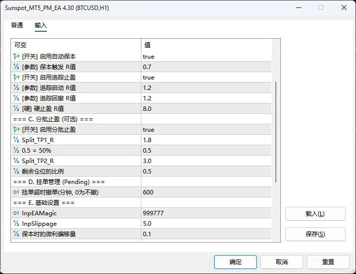

# SunspotAlgo MT5 手动交易风控工具（开源版）

[English](./README.md) | 简体中文

两款面向 **MT5 手动交易者**的免费开源 MQL5 风控辅助 EA，完整支持 Windows 与 macOS（含 Wine / Retina 高分屏自适应）：

1. **[`SunspotAlgo_MT5_Risk_Lock.mq5`](./src/SunspotAlgo_MT5_Risk_Lock.mq5)**（`v2.26`）—— **以损定仓下单面板**（支持市价执行、挂单埋伏、回撤挂单）。
2. **[`SunspotAlgo_MT5_Auto_Manager.mq5`](./src/SunspotAlgo_MT5_Auto_Manager.mq5)**（`v4.33`）—— **自动仓位管理系统**（支持自动保本、追踪止盈、分批止盈、坏报价防线与挂单超时撤单）。

> **使用边界**：这两款工具**不判断方向、不自动喊单、不承诺任何收益**。交易方向与计划始终由交易者自己决定，工具只负责把「先定风险，再下单与管理仓位」的执行流程标准化。本仓库完全免费开源，独立于 [MiX TradingView 信号指标](https://sunspotalgo.com/)。

---

## 配套免费工具与官方入口

- **SunspotAlgo 官方网站：** https://sunspotalgo.com/
- **免费在线以损定仓计算器（外汇 / 黄金 XAUUSD / 加密货币 MT5 规格）：** https://sunspotalgo.com/tools/position-sizing/
- **MT5 风控工具完整使用说明：** https://sunspotalgo.com/docs/mt5-tools/
- **Telegram 公开频道（免费自动转发 MiX 4H 信号）：** https://t.me/SunspotSignal
- **TradingView 指标主页（MiX 信号指标）：** https://www.tradingview.com/script/u7G1zSjA/

---

## 一、SunspotAlgo_MT5_Risk_Lock（v2.26）—— 以损定仓下单面板

先确定这笔交易最多愿意亏损多少金额，再设置止损位，面板自动按当前 MT5 品种合约规格换算出可执行手数。

### 核心功能
- **以损定仓自动算手数**：输入计划承损金额（USD）与止损价，实时计算开仓手数与实际风险。
- **三种入场模式**：
  - **市价执行**：立即按计划止损与风险金额市价开仓。
  - **挂单埋伏**：提前设定入场价与止损价挂单等待触发。
  - **回撤挂单**：按设定回撤比例自动生成挂单，避免追价。
- **Windows / macOS 跨平台适配**：内置 Windows 与 macOS / Wine 字体方案，并修正高 DPI / Retina 屏字号二次放大问题（`Inp_FontSet`、`Inp_UIScale`、`Inp_FontScale`、`Inp_AutoFitFont`）。

### 界面预览

| 市价执行 | 挂单埋伏 | 回撤挂单 |
| --- | --- | --- |
|  |  |  |

---

## 二、SunspotAlgo_MT5_Auto_Manager（v4.33）—— 自动仓位管理系统

开仓后的规则化执行助手，按预先设定的 R 倍数自动处理保本、追踪、分批与挂单超时。

### 核心功能
- **自动保本（`Enable_Auto_BE`）**：浮盈达到 `Inp_BE_Trigger` R 后自动将止损推至保本微利位（`BE_Offset_R`）。
- **追踪止盈（`Enable_Hard_Trail`）**：达到 `Inp_Trail_Start` R 后启动追踪，按 `Inp_Trail_Back` R 回撤保护利润，并在面板实时显示当前锁定的止损 R 值。
- **两段分批止盈（`Enable_Split_TP`）**：到达 `Split_TP1_R`、`Split_TP2_R` 时按设定比例自动平仓减仓。
- **坏报价防线（v4.33）**：过滤未订阅品种或异常 0 报价导致的 R 值计算失真，硬止盈需连续确认，防止单次坏样本误平仓。
- **挂单超时管理（`InpPendingTimeout`）**：挂单超过指定分钟未成交自动撤单（设为 `0` 关闭）。
- **试探单以损定仓联动（`Enable_Risk_Entry`）**：可选开启，配合小手数试探单按目标风险金额自动补足仓位。

### 面板与设置预览

---

## 安装与编译步骤

1. 下载 [`src/SunspotAlgo_MT5_Risk_Lock.mq5`](./src/SunspotAlgo_MT5_Risk_Lock.mq5) 与/或 [`src/SunspotAlgo_MT5_Auto_Manager.mq5`](./src/SunspotAlgo_MT5_Auto_Manager.mq5)。
2. 打开 MetaTrader 5，点击 **文件 → 打开数据文件夹 → `MQL5/Experts/`**，将 `.mq5` 文件复制进去。
3. 打开 **MetaEditor**，载入文件并按 `F7` 编译。
   - **Mac（Apple 芯片 / Wine）编译提示**：编译前请把 MetaEditor 的 CPU 架构设为 **X64 Regular**（避免报错 `failed [568]`），并在 EA 输入参数中将 `Inp_FontSet` 设为 `macOS / Wine`。
4. 在 MT5 顶部开启 **算法交易（Algo Trading）**，将编译好的 EA 拖入图表即可使用。

---

## 风险提示与免责声明

外汇、黄金、指数及加密货币等杠杆交易具有高风险，可能导致本金全部损失。本开源工具基于 MIT 协议按「现状」提供，仅作交易执行与仓位计算辅助，不构成任何投资建议，也不对券商报价、网络延迟或交易结果承担责任。实盘使用前请务必在模拟盘完整测试所有参数。

完整风险披露：https://sunspotalgo.com/risk/
